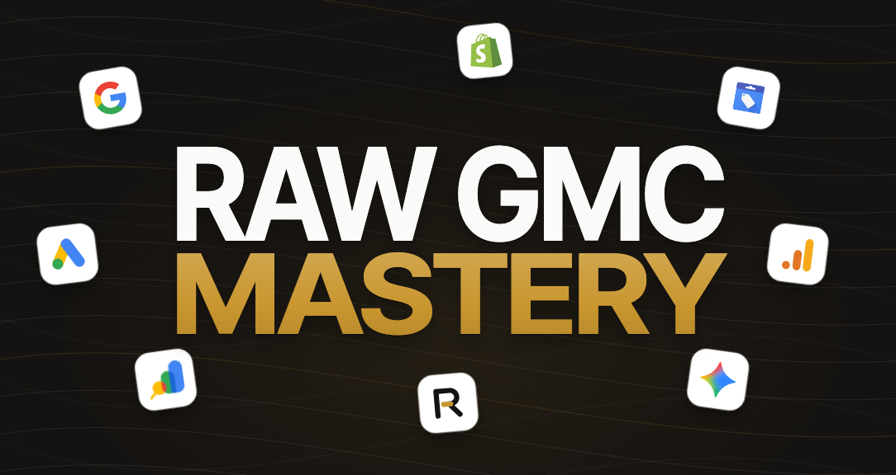

# RAW GMC Mastery · Premium

Les skills et projets réservés aux membres Premium et VIP autorisés. Chaque skill ou projet publié disposera de son propre dépôt privé. Cette présentation est publique ; les ressources restent privées.

- [Catalogue et accueil](https://github.com/RAW-GMC-MASTERY-PREMIUM/premium)
- [Formation et communauté Skool](https://www.skool.com/rawgmcmastery/about)

Les ressources seront ajoutées progressivement. Aucun dépôt de skill n'est encore annoncé comme disponible.

Connecte-toi avec ton compte GitHub invité pour voir les dépôts privés. Une page introuvable peut indiquer que tu n’as pas encore reçu l’accès.
